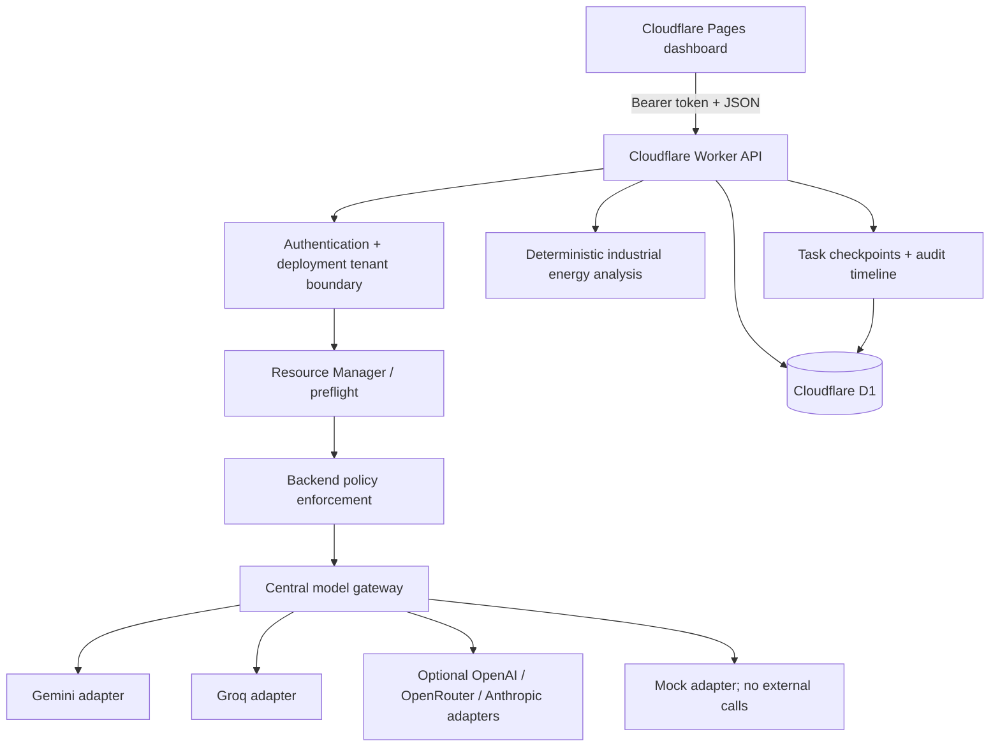

# Master AI — Cloudflare Workers + Pages starter

A fresh, modular build of Master AI. Cloudflare **Workers** hosts the authenticated API, orchestration, provider gateway and security policy. Cloudflare **Pages** serves the dashboard. A Cloudflare **D1** database stores task records, checkpoints, activity events and scoped specialist messages.

> Status honesty: this is a functional first implementation, not the full acceptance-complete platform described in the larger specification. The API, mock execution, Gemini/Groq adapters, optional OpenAI/OpenRouter/Anthropic adapters, preflight/approval, D1 task history, deterministic industrial energy calculations and core policy tests are implemented. See **Known limitations** below before using it for sensitive or production work.

## Architecture



## Folder structure

```text
master-ai-cloudflare/
├── README.md
├── SECURITY.md
├── pages/
│   ├── index.html       # dashboard layout and connection dialog
│   ├── styles.css       # responsive dark UI
│   ├── app.js           # API client, preflight approval, task history and specialist chat
│   ├── _headers         # baseline browser security headers
│   └── _redirects       # SPA fallback
└── worker/
    ├── package.json
    ├── wrangler.toml     # Worker and D1 binding configuration
    ├── .dev.vars.example # local-only secret template; copy to .dev.vars
    ├── migrations/0001_init.sql
    ├── src/
    │   ├── index.js      # API routes, auth boundary and CORS
    │   ├── security/
    │   │   ├── policy.js # auth, tenant check, classification, provider allowlist and redaction
    │   │   └── model-gateway.js # only supported entry point for external AI calls
    │   ├── providers/adapters.js # isolated provider implementations
    │   ├── services/
    │   │   ├── resource-manager.js # preflight and provider eligibility
    │   │   ├── orchestrator.js     # bounded task workflow and checkpoints
    │   │   └── store.js            # tenant-scoped D1 operations and audit timeline
    │   └── agents/
    │       ├── registry.js         # specialist definitions and routing
    │       └── industrial.js       # deterministic energy analysis
    └── test/security.test.js
```

## Run tests locally (no API calls)

Requires Node.js 20+.

```bash
cd worker
npm test
```

The tests use Node's built-in test runner and do not call Gemini, Groq or any other provider. They cover authentication, tenant boundaries, restricted-data blocking, local-only mode, provider allowlists, redaction, preflight and deterministic industrial calculations.

## Deploy using the Cloudflare dashboard

The simplest deployment is to connect this folder structure to a GitHub repository. Commit the project files to a new repository first. **Never commit `.dev.vars`, API keys, or a real `MASTER_API_TOKEN`.**

### A. Create D1

1. Open the Cloudflare dashboard → **Storage & databases → D1 SQL Database** (the menu label may vary).
2. Create a database named `master-ai-db`.
3. Copy its database ID into `worker/wrangler.toml`, replacing `REPLACE_WITH_D1_DATABASE_ID`.
4. Apply `worker/migrations/0001_init.sql` in the D1 SQL console, or run `npx wrangler d1 migrations apply master-ai-db --remote` from the `worker` directory after Wrangler is installed and authenticated.

Do not deploy the API until the D1 binding and migration are ready.

### B. Deploy the Worker backend

1. In Cloudflare dashboard, open **Workers & Pages → Create → Worker** and connect your Git repository using Workers Builds (or use the Wrangler command below).
2. Set the Worker root directory to `worker`.
3. Build/install command: `npm install`.
4. Deploy command: `npx wrangler deploy`.
5. Ensure the deployment uses `worker/wrangler.toml` and the D1 binding name is exactly `DB`.
6. In Worker **Settings → Variables and Secrets**, add these as **secrets**, not plain-text vars:
   - `MASTER_API_TOKEN`: generate a random value at least 32 bytes long; keep it private.
   - `GEMINI_API_KEY`: optional, from Google AI Studio.
   - `GROQ_API_KEY`: optional, from Groq.
   - `OPENAI_API_KEY`, `OPENROUTER_API_KEY`, `ANTHROPIC_API_KEY`: optional, only if you plan to use those providers.
7. Add these as ordinary Worker variables:
   - `DEFAULT_TENANT_ID`: e.g. `primary-tenant` (do not accept tenant IDs from the browser).
   - `PROVIDER_ALLOWLIST`: start with `gemini,groq,mock`; add `openai,openrouter,anthropic` only if configured and intended.
   - `ALLOW_CLOUD_MODELS`: `true` to permit policy-approved external providers; `false` disables all non-mock providers.
   - `SECURITY_PROFILE`: `standard` (reserved for future profile expansion).
   - `PAGES_ORIGIN`: exact dashboard origin, e.g. `https://master-ai-dashboard.pages.dev` (no trailing slash). CORS does not reflect arbitrary origins.
   - Optional model overrides: `GEMINI_MODEL`, `GROQ_MODEL`, `OPENAI_MODEL`, `OPENROUTER_MODEL`, `ANTHROPIC_MODEL`, `ANTHROPIC_MODELS` (comma-separated fallback model IDs for Anthropic model listing).
8. Redeploy after adding configuration.
9. Check `https://YOUR-WORKER.workers.dev/health`. It should return an `ok: true` JSON response. The health route is public and reveals only basic service metadata.

### C. Deploy the Pages dashboard

1. Open **Workers & Pages → Create → Pages → Connect to Git**.
2. Select the same repository.
3. Set the root directory to `pages`.
4. This is a static site: no framework build command is required. Set the output directory to `.` if the dashboard requires one.
5. Deploy the site.
6. Copy the exact Pages origin (for example `https://your-project.pages.dev`) and set it as the Worker variable `PAGES_ORIGIN`. Redeploy the Worker.
7. Open the Pages URL. In the connection dialog, enter the Worker URL and `MASTER_API_TOKEN`. The token is kept in **sessionStorage for that browser tab**; it is not written into the static files. Do not share the token or use a shared computer.

### D. Local Worker development (optional)

```bash
cd worker
npm install
cp .dev.vars.example .dev.vars
# Edit .dev.vars locally; do not commit it.
npx wrangler dev
```

For local API integration, create a local D1 database binding and apply the migration according to Wrangler's D1 local-development instructions. The source unit tests above need no D1 or API keys.

## First-use checklist

1. Select **Mock (no API calls)** and submit a harmless task. Review the resource preflight, then click **Approve and run**.
2. Confirm the result is labelled as mock output.
3. Configure a Gemini or Groq Worker secret and add the provider to `PROVIDER_ALLOWLIST` to use a real model.
4. Open **Providers → Discover models** to retrieve the models the provider currently reports. Select a model ID from that list if the environment model override is not configured.
5. Test local-only mode: it should select the mock provider and never call an external model.
6. For industrial mode, supply structured energy readings in the goal, for example:

```text
Analyze these energy readings using the deterministic local calculator:
{"readings":[{"period":"Shift A","kwh":120,"costPerKwh":8.5},{"period":"Shift B","kwh":150,"costPerKwh":8.5}]}
```

The energy calculator reports arithmetic results and generic recommendations only. It does not control equipment or prove savings.

## API routes

- `GET /health` — public health check.
- `GET /api/meta` — authenticated modes, agents, provider allowlist and security scope.
- `GET /api/tasks` — current deployment tenant's task list.
- `POST /api/tasks` — resource preflight and create an approval-pending task.
- `POST /api/tasks/:id/approve` — explicitly approve and execute the task.
- `GET /api/tasks/:id` — tenant-scoped task record.
- `GET /api/tasks/:id/events` — task activity/audit timeline.
- `POST /api/tasks/:id/agent-message` — scoped follow-up to the assigned specialist, subject to the same policy gateway.
- `GET /api/tasks/:id/agent-messages` — scoped specialist conversation history.
- `POST /api/tasks/:id/resume` — retry/resume eligible failed or paused tasks.
- `POST /api/providers/models` — provider model discovery through the policy gateway.
- `POST /api/industrial/energy` — deterministic energy arithmetic endpoint.

All routes except `/health` require `Authorization: Bearer <MASTER_API_TOKEN>`. The browser never receives the provider API keys.

## Provider architecture

Provider-specific requests live in `worker/src/providers/adapters.js`. Master orchestration calls `worker/src/security/model-gateway.js`; API routes should never import provider adapters directly. Gemini and Groq support runtime model discovery. OpenAI and OpenRouter use compatible `/models` and chat-completion endpoints. Anthropic model IDs use the `ANTHROPIC_MODELS` fallback because the current adapter does not call a model-list API. The allowlist defaults to Gemini, Groq and mock; optional providers are not enabled unless added by the operator.

To add another provider, implement `listModels` and `chatCompletion` in the adapter, define a provider ID, add it to the provider allowlist only after tests, and ensure all requests remain behind `model-gateway.js`. Add negative tests for forbidden provider, privacy and fallback paths.

## Security controls currently implemented

- API routes require a server-side bearer secret; missing or short auth configuration fails closed.
- Tenant identity is fixed from Worker configuration, not a user-supplied header/body. D1 queries scope task reads/updates by tenant ID.
- Data access checks compare the authenticated principal tenant with the row tenant.
- Provider allowlists and cloud-disabled/local-only policies are checked server-side before model calls and model discovery.
- Restricted-classification text is blocked from external providers; mock mode remains available.
- Provider secrets are Worker secrets, never stored in the browser or D1.
- The model gateway is the designated centralized path for all outbound model requests.
- Prompt size is bounded and common secret-like assignments are redacted before model submission; error/audit logs avoid raw prompts and credentials.
- All tasks require review of a resource preflight and explicit approval before execution.
- Industrial analysis is read-only and contains no machinery/PLC write integrations.
- Eight automated tests currently pass; see `worker/test/security.test.js`.

## Known limitations — do not treat this as production-complete

1. **Single tenant per Worker deployment.** This is not multi-user authentication. For a shared/public service, integrate Cloudflare Access or a real identity system and derive each tenant from a verified identity, not the client.
2. **No encrypted multi-key vault/key rotation UI yet.** Provider keys are configured as Worker secrets. Multiple key routing, key health tracking, provider-specific quota telemetry, and fair multi-key scheduling remain future work. Do not rotate keys to evade provider limits.
3. **Durability is basic.** D1 task records and checkpoints are persisted, but task execution is synchronous inside a request; there is no Cloudflare Queues/Workflow background executor yet. Long-running tasks can exceed request limits.
4. **Resume is a bounded retry, not exact-stage replay for every provider failure.** It preserves a checkpoint and result record, but does not yet implement full idempotent stage replay, exponential backoff, or `Retry-After` scheduling.
5. **Subagents are functional scoped specialist prompts, not isolated compute sandboxes.** The current code routes to one specialist per task and supports scoped follow-up messages. It does not yet run parallel subagent graphs or safely execute generated code / edit arbitrary project files.
6. **No uploads or generated artifact filesystem.** File upload scanning, artifact retention/deletion and workspace tools are not implemented.
7. **Model context/capability metadata is partial.** Some providers return context limits; the UI does not yet provide cost estimates or live quota guarantees. Preflight call counts are estimates only.
8. **Data classification is heuristic.** It is a guardrail, not a certified DLP system. Do not submit regulated, highly confidential or production-sensitive data to an external provider without independent review.
9. **Industrial analysis is an example module.** No PLC, SCADA, machine-control, production write, or safety-critical action exists. Human review is mandatory for operational decisions.
10. **No automated integration test has run against a live Cloudflare account or real provider.** Unit tests are local and credential-free. Perform deployment smoke tests before relying on it.

This repository is a working foundation. These limitations are intentionally explicit rather than represented as finished features.
